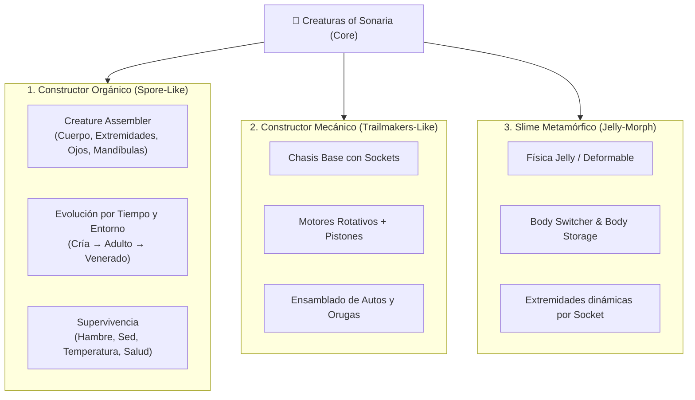

# 🦎 Creaturas of Sonaria — Simulador de Vida, Criaturas Modulares y Fabricación

[](https://godotengine.org)
[](https://microsoft.com/windows)
[](https://godotengine.org)
[](LICENSE)
[](https://github.com/cesaralejandromartesbonilla-a11y/creaturas-of-sonaria)

Ecosistema sandbox de supervivencia, evolución biológica y construcción modular desarrollado en **Godot 4.6**. Integra tres sistemas principales: un **constructor de criaturas orgánicas tipo Spore**, un **constructor de vehículos modulares tipo Trailmakers / Screw Drivers** y una **criatura slime metamórfica** con sockets interactivos y física gelatinosa.

---

## 🧬 Los 3 Mini-Proyectos Integrados



---

## 🚀 Cómo Ejecutar el Proyecto

1. **Requisitos:** Godot Engine 4.6 (soporta exportación C# y GDScript con Forward Plus).
2. **Escena Principal (`F5`):**
   - [`res://ecenas/main_menu.tscn`](file:///c:/Users/cesar/Desktop/games/backup/GodotProjects/00_Active/creaturas-of-sonaria/ecenas/main_menu.tscn) — Menú principal con selección de criaturas y tienda.
3. **Escenas de los Sistemas Principales (`F6`):**
   - **Constructor de Quimeras / Spore:** `res://slime_test/test/CreatureAssembler.tscn` (Interfaz interactiva de ensamblado con `ChimeraBuilderHUD`).
   - **Constructor de Vehículos por Bloques:** `res://scripts_car/construccion.tscn` (Mesa de montaje tipo Trailmakers).
   - **Mundo Sandbox con Simulación:** `res://ecenas/world.tscn` (Ecosistema con clima dinámico, parcelas agrícolas y maquinaria).
   - **Sandbox del Slime Metamórfico:** `res://slime_test/escenario.tscn` (Pruebas de cambio de cuerpos y física blanda).

---

## 🌟 Características y Mecánicas Detalladas

### 1. Sistema Biológico y Evolución de Criaturas
- **Etapas de crecimiento:** Progresión cronológica y ambiental (`Cría` $\rightarrow$ `Adolescente` $\rightarrow$ `Adulto` $\rightarrow$ `Anciano` $\rightarrow$ `Venerado`).
- **Etapas especiales condicionales:** Mutaciones elementales (ej. exposición prolongada al fuego desbloquea variantes ígneas).
- **Módulos de Criatura:**
  - `SurvivalManager`: Gestión de hambre, sed, resistencia térmica y vitalidad.
  - `AbilityManager`: Lanzamiento de habilidades activas (`fireball.tscn`, `freeze.tscn`, `heal_area.tscn`).
  - `LocomotionController`: Soporte multimodal para caminar, trepar y nadar.

### 2. Constructor de Criaturas (Chimera Assembler)
- **Sockets Interactivos (`InteractiveSocket`):** Puntos de acople normalizados donde conectar brazos, patas, colas o cabezas.
- **Bone Attachment dinámico:** Generación de esqueletos articulados (`BoneChainBuilder`) y capas visuales deformables (`BoneVisualLayer`).
- **Exportación en partida:** Instanciación en el mundo de la criatura creada con sus estadísticas calculadas (`spawned_creature.tscn`).

### 3. Constructor de Maquinaria y Factoría
- **Ensamblado modular:** Sockets de conexión para unir bloques de carrocería, ruedas, orugas y transmisiones.
- **Red de Energía (`PowerManager.gd`):** Postes de tendido eléctrico (`PowerPole.tscn`), generadores y hornos industriales.
- **Automatización:** Cintas transportadoras (`cinta_transportadora.tscn`), pistones y centros de control de motores (`MotorCommandCenter.tscn`).
- **Agricultura procedural:** Parcelas de cultivo (`crop_plot.tscn`) con crecimiento dinámico de árboles y manzanos procedurales.

### 4. Clima y Atmósfera Dinámica (`WeatherManager.gd`)
- Nubes volumétricas procedurales (`models/clima/cloud.tscn`).
- Fenómenos climáticos extremos con fuerza física (Tornados interactivos: `models/clima/tornado.tscn`).

---

## 🎮 Controles Principales

| Acción | Teclas | Función |
| :--- | :---: | :--- |
| **Movimiento** | `W` / `A` / `S` / `D` | Desplazamiento de criatura / cámara |
| **Correr / Sprint** | `Shift` | Aumenta velocidad a costa de energía |
| **Saltar** | `Espacio` | Salto de la criatura |
| **Habilidades Activas** | `1`, `2`, `3` | Lanzar Bola de fuego, Escarcha o Área de cura |
| **Interactuar / Agarrar** | `E` / `F` | Montar en vehículo, abrir paneles, recoger ítems |
| **Panel de Habilidades** | `Tab` / `Q` | Desplegar menú de magias y destrezas |
| **Cambio de Cuerpo (Slime)** | `C` / `V` | Alternar entre formas corporales almacenadas |
| **Modo Construcción** | `B` / `G` | Colocar sockets / bloques de vehículo |
| **Cámara** | `Clic Derecho + Mouse` | Rotación orbital de la cámara |
| **Zoom** | `Rueda del Ratón` | Distancia del visor |

---

## 📁 Estructura del Proyecto

```
creaturas-of-sonaria/
├── creatures/
│   ├── creatures/             # Escenas de cuerpos base (CharacterBody3D)
│   ├── scripts of creatures/  # Controladores de movimiento y GUI biológica
│   └── scrpt modules/         # Módulos: Ability, Combat, Survival, Evolution, StatScaler
├── slime_test/
│   ├── test/                  # CreatureAssembler.tscn, ChimeraBuilderHUD, BoneChainBuilder
│   ├── recursos/              # Definiciones de chasis y formas de slime
│   └── *.gd                   # BodySwitcher, BodyStorage, Locomotion, Sockets
├── scripts_car/
│   ├── construccion.tscn      # Taller de ensamblado tipo Trailmakers
│   └── demo_car.tscn          # Vehículo funcional montado con bloques
├── ecenas/
│   ├── mesas/                 # Cintas transportadoras, hornos, generadores, PowerPoles
│   ├── parcela/               # Cultivos dinámicos y manzanos procedurales
│   └── main_menu.tscn         # Menú principal y selector
├── habilidades/               # Bolas de fuego, congelación, regeneración y HUD
├── rope_system/               # Mecánicas de cuerdas físicas y acoples elásticos
├── models/                    # Modelos 3D y elementos climáticos (tornado, nubes)
├── texturas/                  # Texturas estilizadas y shaders de gelatina/disolución
└── autoloads/                 # InventoryManager, WeatherManager, PowerManager, LogicManager
```

---

## 📄 Licencia

Código propio bajo licencia MIT. Addons y recursos de terceros bajo sus respectivas licencias comunitarias.
